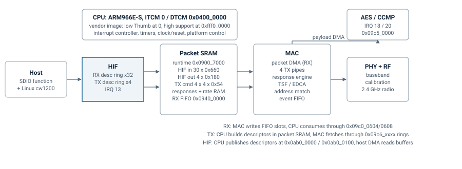

# Hardware address map

Start with a CPU address, then follow the block to see what the firmware reads or writes. A bus address in a descriptor is not a CPU pointer.

The core uses a sparse 32-bit address space. Code and data live in two tightly coupled memories (ITCM at 0, DTCM at `0x0400_0000`); packet memory is a separate SRAM bank reached at `0x0900_0000`; peripherals occupy `0x09c0_0000` to `0x0acc_0000`; a small high SRAM at `0xfff0_0000` holds the vendor bootstrap.

## Aperture summary
{:#s2-1}



The debug UART is separate from these named layouts. Vendor code accesses it at `0x0a900000`; see the [interrupt source notes](interrupts.html). For ITCM, DTCM and high SRAM, see [image destinations](boot.html).

## Packet SRAM object map
{:#s2-2}

Packet SRAM is not flat from the hardware's point of view. The four hardware users (HIF, packet DMA, TX pipes, AES) each address it with their own encoding, and the CPU uses the plain address. The *object* layout below is fixed by the vendor image and reproduced byte-for-byte by the Rust linker script.

| Object | CPU address | Count × size | Hardware user |
| --- | --- | --- | --- |
| HIF input buffers | 0x0900_7000 | 30 × 0x660 | Host writes, firmware reads (HIF RX descriptors) |
| HIF output buffers | after the input pool | 4 × 0x180 | Firmware writes, host reads (HIF TX descriptors) |
| TX command slots | pool start | 4 pipes × 4 slots × 0x54 | CPU builds, MAC pipe fetch reads |
| Response commands | pool start | 13 × descriptor | CPU builds, MAC response engine reads (beacon, ACK/CTS, BlockAck, TBTT) |
| Response pointers | pool start | 32 × 4 | Published at `0x09c0_0c00`; indexed by pipe slot |
| Automatic response list | pool start | 0x8c | Head word `0x4e14_0000`, 33 entries, terminator `0xf000_0000` |
| Rate RAM | pool start | 80 × 0x10 | Published at `0x09c0_0800`; 4-word entries (airtime, encoding+class, durations) |
| Duration table | pool start | 2 × 16-bit | Referenced by command opcode `0x21` |
| Interface metadata | pool start | 4 bytes | Byte OR'd by the MAC into the high frame-control octet (command `0x2080_0000`) |
| Host frame state nodes | pool start | 30 × 0x54 | Per-publication context retained by the TX pipe registry |
| Software records | pool start | 4 × 0x2a0 | A-MPDU per-pipe transfer records |
| RX FIFO | 0x0940_0000 | 0x8000 storage | Packet DMA writes, CPU reads |

The runtime pool occupies `0x0900_7000..0x0901_6630`. Absolute addresses inside it are firmware-private; the hardware only ever sees the [encoded forms](addresses.html).
